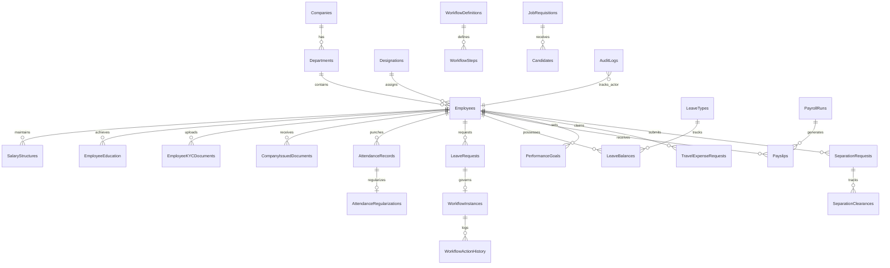

# ENTERPRISE HRMS & PEOPLEWORKS PLATFORM - MASTER SPECIFICATION & REBUILD BLUEPRINT

> **AUTONOMOUS DEV TOOL DIRECTIVE / PROMPT INSTRUCTION:**
> You are an expert Full-Stack Software Architect and Autonomous Senior Engineer. 
> This document contains the complete, unabridged architectural, business, database, API, and UI specification for an enterprise-grade Human Resource Management System (HRMS) modeled after **PeopleWorks**, **Darwinbox**, and **Workday**.
>
> If you are an AI developer tool (e.g. Antigravity, Cursor, Claude, ChatGPT, GitHub Copilot) instructed to *"build this project"* using this file:
> 1. Read every section sequentially.
> 2. Follow the exact Database Schema (MS SQL Server / In-Memory Mock DB).
> 3. Implement all 10 Personas and Granular Role-Based Access Control (RBAC).
> 4. Implement all 30+ REST API endpoints in the Express / Node.js backend.
> 5. Implement all 17 Frontend Modules in Angular 19+ (Standalone Components, Signals, Reactive Forms, Lucide Icons, Tailwind CSS v4) or React 19 equivalent.
> 6. Adhere to all statutory formulas (PF 12%, PT ₹200, TDS), workflow approval chains, and automated candidate-to-employee onboarding conversions.

---

## TABLE OF CONTENTS
1. [Executive Summary & Business Value ("Kyon" - Why This Exists)](#1-executive-summary--business-value-kyon---why-this-exists)
2. [Technology Stack & System Architecture](#2-technology-stack--system-architecture)
3. [Authentication, Security & 10 Enterprise Personas (RBAC)](#3-authentication-security--10-enterprise-personas-rbac)
4. [Relational Database Architecture & SQL Server Schema](#4-relational-database-architecture--sql-server-schema)
5. [In-Memory State Store & Seed Data Model](#5-in-memory-state-store--seed-data-model)
6. [Complete Backend REST API Specification](#6-complete-backend-rest-api-specification)
7. [Module-by-Module Specifications ("Kya, Kaise, Kyon" - All 17 Modules)](#7-module-by-module-specifications-kya-kaise-kyon---all-17-modules)
   - [7.1 Authentication & Fast Persona Switching (`/login`)](#71-authentication--fast-persona-switching-login)
   - [7.2 Executive & Employee Command Dashboard (`/dashboard`)](#72-executive--employee-command-dashboard-dashboard)
   - [7.3 Employee Directory & Profile Viewer (`/employees`)](#73-employee-directory--profile-viewer-employees)
   - [7.4 Employee Self-Service & Document Vault (`/profile`, `/documents`)](#74-employee-self-service--document-vault-profile-documents)
   - [7.5 Biometric Attendance & Regularization Engine (`/attendance`)](#75-biometric-attendance--regularization-engine-attendance)
   - [7.6 Leave Quota & Application Engine (`/leave`)](#76-leave-quota--application-engine-leave)
   - [7.7 Unified Approvals Command Hub (`/approvals`)](#77-unified-approvals-command-hub-approvals)
   - [7.8 Dynamic Workflow Approval Engine (`/workflows`)](#78-dynamic-workflow-approval-engine-workflows)
   - [7.9 Payroll Batch Engine & Digital Payslip System (`/payroll`, `/salary`)](#79-payroll-batch-engine--digital-payslip-system-payroll-salary)
   - [7.10 Talent Acquisition & ATS Auto-Conversion (`/recruitment`)](#710-talent-acquisition--ats-auto-conversion-recruitment)
   - [7.11 Performance Management & Appraisal Scorecard (`/performance`)](#711-performance-management--appraisal-scorecard-performance)
   - [7.12 Travel & Expense Reimbursement Hub (`/travel-expenses`)](#712-travel--expense-reimbursement-hub-travel-expenses)
   - [7.13 Separation, Asset Clearance & Terminal F&F Settlement (`/separation`)](#713-separation-asset-clearance--terminal-ff-settlement-separation)
   - [7.14 Organization Hierarchy & Master Configurations (`/organization`)](#714-organization-hierarchy--master-configurations-organization)
   - [7.15 My Team Roster & Attendance Tracking (`/team`)](#715-my-team-roster--attendance-tracking-team)
   - [7.16 Enterprise Audit Trail & Compliance Logging (`/audit-logs`)](#716-enterprise-audit-trail--compliance-logging-audit-logs)
   - [7.17 Workforce Intelligence & Real CSV Export Engine (`/reports`)](#717-workforce-intelligence--real-csv-export-engine-reports)
   - [7.18 Employee Helpdesk, Service Requests & Query Resolution (`/helpdesk`)](#718-employee-helpdesk-service-requests--query-resolution-helpdesk)
8. [Frontend Layout, Navigation & Design System](#8-frontend-layout-navigation--design-system)
9. [Step-by-Step AI Dev Tool Build Instructions (From Scratch to Production)](#9-step-by-step-ai-dev-tool-build-instructions-from-scratch-to-production)

---

## 1. EXECUTIVE SUMMARY & BUSINESS VALUE ("KYON" - WHY THIS EXISTS)

### 1.1 The Business Problem
Enterprise organizations with 500 to 50,000+ employees require a single, centralized source of truth for the complete employee lifecycle (Hire-to-Retire). Traditional spreadsheets or fragmented point solutions cause:
- **Data Duplication & Inconsistencies:** Employee details, salaries, bank accounts, and attendance are scattered.
- **Statutory Non-Compliance:** Human errors in calculating Provident Fund (PF), Professional Tax (PT), and Tax Deducted at Source (TDS).
- **Delayed Approvals:** Leave and expense requests get bottlenecked in email threads without audit logs or escalation SLAs.
- **Leaked Assets during Offboarding:** Departments (IT, Finance, Admin) miss clearance sign-offs, leading to financial loss.

### 1.2 The Solution: PeopleWorks Enterprise HRMS
A high-performance, modular monolithic web platform that integrates:
1. **Core HR & Organization Structure:** Deep organizational master hierarchy with grade bands, designations, cost centers, and branch locations.
2. **Biometric Web Punch & Regularization:** Accurate attendance capture with automated late arrival and early departure calculations.
3. **Configurable Dynamic Workflow Engine:** Multi-level approval chains (Reporting Manager -> HR Admin -> Finance Admin) without code modifications.
4. **Statutory Indian Payroll:** Fully automated computation of Basic, HRA, Special Allowance, PF (12%), PT (₹200), and TDS withholding with dual-gate batch disbursement.
5. **Talent Acquisition to Employee Provisioning:** Automated conversion of candidates to employees upon reaching 'Joined' status.
6. **Separation & F&F Terminal Settlement:** 4-department clearance protocol and automated final settlement calculator.
7. **Tamper-Evident Audit Logging:** Real-time recording of all data mutations with user ID, timestamps, old vs new values, and client IP.

---

## 2. TECHNOLOGY STACK & SYSTEM ARCHITECTURE

```
+-------------------------------------------------------------------------------+
|                       CLIENT TIER: SINGLE PAGE APP                            |
|  - Angular 19+ (Standalone Components, Signals, Reactive Forms, Router)      |
|  - Tailwind CSS v4 + @lucide/angular icons                                    |
|  - High-density enterprise UX with dark-mode slate accents & micro-animations|
+---------------------------------------+---------------------------------------+
                                        | HTTP REST (JSON / Multipart)
                                        v
+-------------------------------------------------------------------------------+
|                    APPLICATION TIER: EXPRESS / NODE.JS TS                     |
|  - TypeScript (TSX runtime), Express 4.x                                      |
|  - Modular Controllers (Auth, Employees, Attendance, Leaves, Payroll, ATS)    |
|  - Real-time Audit Logger & In-app Notification Dispatcher                   |
+---------------------------------------+---------------------------------------+
                                        |
                    +-------------------+-------------------+
                    |                                       |
                    v                                       v
+---------------------------------------+   +-----------------------------------+
|     PRODUCTION PERSISTENCE LAYER      |   |       LOCAL DEV / MOCK DB         |
|  - Microsoft SQL Server 2022 / Azure  |   |  - Typed In-Memory State Store    |
|  - Normalized 3NF Relational Schema   |   |  - Pre-seeded with 10 Personas,   |
|  - Foreign Keys, Constraints, Indexes |   |    10+ Employees, Payslips, ATS   |
+---------------------------------------+   +-----------------------------------+
```

### Key Dependencies (`package.json`)
- **Frontend:**
  - `@angular/core`: `^19.2.0`
  - `@angular/common`: `^19.2.0`
  - `@angular/router`: `^19.2.0`
  - `@angular/forms`: `^19.2.0`
  - `@lucide/angular`: `^1.48.0`
  - `tailwindcss`: `^4.3.3`
  - `@tailwindcss/postcss`: `^4.3.3`
- **Backend:**
  - `express`: `^4.21.2`
  - `tsx`: `^4.21.0`
  - `@types/node`: `^22.14.0`
  - `@types/express`: `^4.17.21`

---

## 3. AUTHENTICATION, SECURITY & 10 ENTERPRISE PERSONAS (RBAC)

### 3.1 Universal Master Credentials
- **Default Master Password (for all seeded users):** `jacksonandfranc@123`
- **Session Keys:** 
  - `hrms_user`: Serialized JSON user object stored in browser `localStorage`.
  - `hrms_token`: Bearer token string stored in browser `localStorage`.

### 3.2 The 10 Enterprise Personas
| Role | Seeded Email | Name | Department | Primary Permissions |
|---|---|---|---|---|
| **Super Admin** | `it@jacksonandfrank.com` | Jackson & Frank IT Admin | Global Technology | `*` (Full System Access) |
| **Super Admin** | `admin@democorp.com` | Ananya Roy | Human Resources | `*` (Enterprise Operations) |
| **HR Admin** | `hr@democorp.com` | Sneha Kulkarni | Human Resources | `Employee.*`, `Leave.*`, `Attendance.*`, `Recruitment.*`, `Onboarding.*`, `Separation.*` |
| **Manager** | `manager@democorp.com` | Rajesh Sharma | Engineering | `Employee.View`, `Team.*`, `Leave.Approve`, `Attendance.Approve`, `Performance.Approve` |
| **Employee** | `priya@democorp.com` | Priya Nair | Engineering | `Self.*` (Personal Profile, Punch, Leave Apply, Expenses, Documents) |
| **Payroll Admin** | `payroll@democorp.com` | Deepak Verma | Finance & Accounts | `Payroll.*`, `Employee.View`, `Salary.*` |
| **Finance** | `finance@democorp.com` | Vikram Patil | Finance & Accounts | `Finance.*`, `Expense.Approve`, `Travel.Approve` |
| **Recruiter** | `recruiter@democorp.com` | Kavita Sen | Talent Acquisition | `Recruitment.*`, `Onboarding.View` |
| **Training Admin** | `training@democorp.com` | Amit Trivedi | Learning & Dev | `Training.*`, `Employee.View` |
| **Performance Admin**| `performance@democorp.com`| Neha Joshi | HR Strategy | `Performance.*`, `Employee.View` |

### 3.3 Persona Switching & Access Control Mechanism
1. **Interactive Persona Switcher:** The top navigation bar and login screen both contain an instant Persona Switcher. Clicking any persona immediately re-authenticates the session without retyping credentials.
2. **Client-Side Guard (`authGuard`):** Protects all routes except `/login`. If `localStorage.getItem('hrms_user')` is null or invalid, redirects to `/login`.
3. **Permission Check Utility:**
   ```typescript
   hasPermission(requiredPermission: string): boolean {
     const user = this.currentUser();
     if (!user) return false;
     if (user.permissions.includes('*')) return true;
     return user.permissions.some(p => {
       if (p.endsWith('.*')) {
         const module = p.split('.')[0];
         return requiredPermission.startsWith(module + '.');
       }
       return p === requiredPermission;
     });
   }
   ```

---

## 4. RELATIONAL DATABASE ARCHITECTURE & SQL SERVER SCHEMA

### 4.1 Entity Relationship Diagram (ERD)


### 4.2 SQL Server 2022+ DDL Script

```sql
-- =====================================================================
-- ENTERPRISE HRMS / PEOPLEWORKS PLATFORM DATABASE SCHEMA (MS SQL SERVER)
-- =====================================================================

CREATE DATABASE [EnterpriseHRMS];
GO
USE [EnterpriseHRMS];
GO

-- 1. ORGANIZATION STRUCTURE
CREATE TABLE [dbo].[Companies] (
    [CompanyId] INT IDENTITY(1,1) PRIMARY KEY,
    [CompanyCode] NVARCHAR(20) NOT NULL UNIQUE,
    [CompanyName] NVARCHAR(150) NOT NULL,
    [CIN] NVARCHAR(30) NULL,
    [RegistrationAddress] NVARCHAR(500) NOT NULL,
    [IsActive] BIT NOT NULL DEFAULT 1,
    [CreatedAt] DATETIME2 NOT NULL DEFAULT SYSUTCDATETIME()
);

CREATE TABLE [dbo].[Departments] (
    [DepartmentId] INT IDENTITY(1,1) PRIMARY KEY,
    [CompanyId] INT NOT NULL FOREIGN KEY REFERENCES [dbo].[Companies]([CompanyId]),
    [DepartmentCode] NVARCHAR(20) NOT NULL UNIQUE,
    [DepartmentName] NVARCHAR(100) NOT NULL,
    [ParentDepartmentId] INT NULL FOREIGN KEY REFERENCES [dbo].[Departments]([DepartmentId]),
    [IsActive] BIT NOT NULL DEFAULT 1
);

CREATE TABLE [dbo].[Designations] (
    [DesignationId] INT IDENTITY(1,1) PRIMARY KEY,
    [DesignationCode] NVARCHAR(20) NOT NULL UNIQUE,
    [DesignationTitle] NVARCHAR(100) NOT NULL,
    [Band] NVARCHAR(20) NOT NULL,     -- Band 1 through Band 6
    [JobLevel] NVARCHAR(20) NOT NULL, -- L1 through L7
    [IsActive] BIT NOT NULL DEFAULT 1
);

CREATE TABLE [dbo].[Locations] (
    [LocationId] INT IDENTITY(1,1) PRIMARY KEY,
    [LocationCode] NVARCHAR(20) NOT NULL UNIQUE,
    [City] NVARCHAR(100) NOT NULL,
    [State] NVARCHAR(100) NOT NULL,
    [Country] NVARCHAR(100) NOT NULL DEFAULT 'India',
    [PostalCode] NVARCHAR(20) NOT NULL,
    [IsActive] BIT NOT NULL DEFAULT 1
);

-- 2. EMPLOYEE MASTER & PROFILES
CREATE TABLE [dbo].[Employees] (
    [EmployeeId] INT IDENTITY(1,1) PRIMARY KEY,
    [EmployeeCode] NVARCHAR(30) NOT NULL UNIQUE,  -- e.g. PW-1001
    [FirstName] NVARCHAR(100) NOT NULL,
    [LastName] NVARCHAR(100) NOT NULL,
    [OfficialEmail] NVARCHAR(150) NOT NULL UNIQUE,
    [MobilePhone] NVARCHAR(25) NOT NULL,
    [DateOfBirth] DATE NOT NULL,
    [Gender] NVARCHAR(20) NOT NULL,
    [BloodGroup] NVARCHAR(10) NULL,
    [MaritalStatus] NVARCHAR(20) NOT NULL,
    [DateOfJoining] DATE NOT NULL,
    [ConfirmationDate] DATE NULL,
    [ProbationEndDate] DATE NULL,
    [EmploymentType] NVARCHAR(30) NOT NULL DEFAULT 'Full-Time',
    [EmploymentStatus] NVARCHAR(30) NOT NULL DEFAULT 'Active', -- Active, Probation, Notice Period, Separated
    [CompanyId] INT NOT NULL FOREIGN KEY REFERENCES [dbo].[Companies]([CompanyId]),
    [DepartmentId] INT NOT NULL FOREIGN KEY REFERENCES [dbo].[Departments]([DepartmentId]),
    [DesignationId] INT NOT NULL FOREIGN KEY REFERENCES [dbo].[Designations]([DesignationId]),
    [LocationId] INT NOT NULL FOREIGN KEY REFERENCES [dbo].[Locations]([LocationId]),
    [ReportingManagerId] INT NULL FOREIGN KEY REFERENCES [dbo].[Employees]([EmployeeId]),
    [CostCenterCode] NVARCHAR(50) NOT NULL,
    [CurrentAddress] NVARCHAR(500) NOT NULL,
    [PermanentAddress] NVARCHAR(500) NOT NULL,
    [EmergencyContactName] NVARCHAR(100) NOT NULL,
    [EmergencyContactRelation] NVARCHAR(50) NOT NULL,
    [EmergencyContactPhone] NVARCHAR(25) NOT NULL,
    [ProfilePictureUrl] NVARCHAR(500) NULL,
    [CreatedAt] DATETIME2 NOT NULL DEFAULT SYSUTCDATETIME(),
    [UpdatedAt] DATETIME2 NULL,
    [IsDeleted] BIT NOT NULL DEFAULT 0
);
CREATE NONCLUSTERED INDEX [IX_Employees_Dept_Status] ON [dbo].[Employees]([DepartmentId], [EmploymentStatus]);
CREATE NONCLUSTERED INDEX [IX_Employees_Manager] ON [dbo].[Employees]([ReportingManagerId]);

-- 3. SALARY STRUCTURE & STATUTORY MANDATE
CREATE TABLE [dbo].[SalaryStructures] (
    [SalaryStructureId] INT IDENTITY(1,1) PRIMARY KEY,
    [EmployeeId] INT NOT NULL FOREIGN KEY REFERENCES [dbo].[Employees]([EmployeeId]),
    [CTCAnnual] DECIMAL(18,2) NOT NULL,
    [BasicMonthly] DECIMAL(18,2) NOT NULL,
    [HRAMonthly] DECIMAL(18,2) NOT NULL,
    [SpecialAllowanceMonthly] DECIMAL(18,2) NOT NULL,
    [PFMonthly] DECIMAL(18,2) NOT NULL,
    [ProfessionalTax] DECIMAL(18,2) NOT NULL,
    [BankName] NVARCHAR(100) NULL,
    [BankAccountNumber] NVARCHAR(50) NULL,
    [IFSCCode] NVARCHAR(20) NULL,
    [PANNumber] NVARCHAR(20) NULL,
    [AadhaarNumber] NVARCHAR(20) NULL,
    [UANNumber] NVARCHAR(30) NULL,
    [PaymentMode] NVARCHAR(30) NOT NULL DEFAULT 'Bank Transfer',
    [EffectiveFrom] DATE NOT NULL,
    [IsCurrent] BIT NOT NULL DEFAULT 1
);

-- 4. ATTENDANCE & BIOMETRIC LOGS
CREATE TABLE [dbo].[AttendanceRecords] (
    [AttendanceId] BIGINT IDENTITY(1,1) PRIMARY KEY,
    [EmployeeId] INT NOT NULL FOREIGN KEY REFERENCES [dbo].[Employees]([EmployeeId]),
    [AttendanceDate] DATE NOT NULL,
    [FirstInTime] TIME(0) NULL,
    [LastOutTime] TIME(0) NULL,
    [TotalWorkMinutes] INT NOT NULL DEFAULT 0,
    [BreakMinutes] INT NOT NULL DEFAULT 0,
    [OvertimeMinutes] INT NOT NULL DEFAULT 0,
    [Status] NVARCHAR(20) NOT NULL, -- Present, Late, Half Day, Absent, On Leave, Holiday
    [IsLate] BIT NOT NULL DEFAULT 0,
    [IsEarlyLeaving] BIT NOT NULL DEFAULT 0,
    [CreatedAt] DATETIME2 NOT NULL DEFAULT SYSUTCDATETIME(),
    CONSTRAINT [UQ_Employee_AttendanceDate] UNIQUE ([EmployeeId], [AttendanceDate])
);

CREATE TABLE [dbo].[AttendanceRegularizations] (
    [RegularizationId] INT IDENTITY(1,1) PRIMARY KEY,
    [AttendanceId] BIGINT NOT NULL FOREIGN KEY REFERENCES [dbo].[AttendanceRecords]([AttendanceId]),
    [EmployeeId] INT NOT NULL FOREIGN KEY REFERENCES [dbo].[Employees]([EmployeeId]),
    [RequestedInTime] TIME(0) NOT NULL,
    [RequestedOutTime] TIME(0) NOT NULL,
    [ReasonCategory] NVARCHAR(100) NOT NULL,
    [EmployeeRemarks] NVARCHAR(500) NOT NULL,
    [Status] NVARCHAR(20) NOT NULL DEFAULT 'Pending', -- Pending, Approved, Rejected
    [ApprovedByEmployeeId] INT NULL FOREIGN KEY REFERENCES [dbo].[Employees]([EmployeeId]),
    [ApprovedAt] DATETIME2 NULL,
    [ManagerRemarks] NVARCHAR(500) NULL,
    [CreatedAt] DATETIME2 NOT NULL DEFAULT SYSUTCDATETIME()
);

-- 5. WORKFLOW ENGINE
CREATE TABLE [dbo].[WorkflowDefinitions] (
    [WorkflowId] INT IDENTITY(1,1) PRIMARY KEY,
    [WorkflowCode] NVARCHAR(50) NOT NULL UNIQUE,
    [WorkflowName] NVARCHAR(150) NOT NULL,
    [Module] NVARCHAR(50) NOT NULL, -- Leave, Attendance, Expense, Separation
    [IsActive] BIT NOT NULL DEFAULT 1
);

CREATE TABLE [dbo].[WorkflowSteps] (
    [WorkflowStepId] INT IDENTITY(1,1) PRIMARY KEY,
    [WorkflowId] INT NOT NULL FOREIGN KEY REFERENCES [dbo].[WorkflowDefinitions]([WorkflowId]),
    [StepNumber] INT NOT NULL,
    [StepName] NVARCHAR(100) NOT NULL,
    [ApproverType] NVARCHAR(50) NOT NULL, -- Reporting Manager, Department Head, HR Admin, Finance Admin
    [SlaDays] INT NOT NULL DEFAULT 3,
    CONSTRAINT [UQ_Workflow_Step] UNIQUE ([WorkflowId], [StepNumber])
);

CREATE TABLE [dbo].[WorkflowInstances] (
    [InstanceId] BIGINT IDENTITY(1,1) PRIMARY KEY,
    [WorkflowId] INT NOT NULL FOREIGN KEY REFERENCES [dbo].[WorkflowDefinitions]([WorkflowId]),
    [EntityName] NVARCHAR(50) NOT NULL,
    [EntityId] NVARCHAR(50) NOT NULL,
    [CurrentStepNumber] INT NOT NULL DEFAULT 1,
    [Status] NVARCHAR(30) NOT NULL DEFAULT 'Pending' -- Pending, Approved, Rejected, Cancelled
);

CREATE TABLE [dbo].[WorkflowActionHistory] (
    [ActionId] BIGINT IDENTITY(1,1) PRIMARY KEY,
    [InstanceId] BIGINT NOT NULL FOREIGN KEY REFERENCES [dbo].[WorkflowInstances]([InstanceId]),
    [StepNumber] INT NOT NULL,
    [ActorEmployeeId] INT NOT NULL FOREIGN KEY REFERENCES [dbo].[Employees]([EmployeeId]),
    [Action] NVARCHAR(30) NOT NULL, -- Submitted, Approved, Rejected, Sent Back
    [Remarks] NVARCHAR(1000) NULL,
    [ActionTimestamp] DATETIME2 NOT NULL DEFAULT SYSUTCDATETIME()
);

-- 6. LEAVE MANAGEMENT
CREATE TABLE [dbo].[LeaveTypes] (
    [LeaveTypeId] INT IDENTITY(1,1) PRIMARY KEY,
    [LeaveTypeCode] NVARCHAR(20) NOT NULL UNIQUE,
    [LeaveTypeName] NVARCHAR(50) NOT NULL,
    [AnnualQuota] DECIMAL(5,2) NOT NULL,
    [IsCarryForwardAllowed] BIT NOT NULL DEFAULT 0,
    [IsPaidLeave] BIT NOT NULL DEFAULT 1
);

CREATE TABLE [dbo].[LeaveBalances] (
    [BalanceId] INT IDENTITY(1,1) PRIMARY KEY,
    [EmployeeId] INT NOT NULL FOREIGN KEY REFERENCES [dbo].[Employees]([EmployeeId]),
    [LeaveTypeId] INT NOT NULL FOREIGN KEY REFERENCES [dbo].[LeaveTypes]([LeaveTypeId]),
    [FiscalYear] INT NOT NULL,
    [TotalQuota] DECIMAL(5,2) NOT NULL,
    [Used] DECIMAL(5,2) NOT NULL DEFAULT 0,
    [PendingApproval] DECIMAL(5,2) NOT NULL DEFAULT 0,
    [Available] AS ([TotalQuota] - [Used] - [PendingApproval]),
    CONSTRAINT [UQ_Employee_Leave_Year] UNIQUE ([EmployeeId], [LeaveTypeId], [FiscalYear])
);

CREATE TABLE [dbo].[LeaveRequests] (
    [LeaveRequestId] BIGINT IDENTITY(1,1) PRIMARY KEY,
    [RequestCode] NVARCHAR(30) NOT NULL UNIQUE,
    [EmployeeId] INT NOT NULL FOREIGN KEY REFERENCES [dbo].[Employees]([EmployeeId]),
    [LeaveTypeId] INT NOT NULL FOREIGN KEY REFERENCES [dbo].[LeaveTypes]([LeaveTypeId]),
    [StartDate] DATE NOT NULL,
    [EndDate] DATE NOT NULL,
    [NumberOfDays] DECIMAL(5,2) NOT NULL,
    [Reason] NVARCHAR(500) NOT NULL,
    [Status] NVARCHAR(20) NOT NULL DEFAULT 'Pending',
    [WorkflowInstanceId] BIGINT NULL FOREIGN KEY REFERENCES [dbo].[WorkflowInstances]([InstanceId]),
    [CreatedAt] DATETIME2 NOT NULL DEFAULT SYSUTCDATETIME()
);

-- 7. PAYROLL & DISBURSEMENTS
CREATE TABLE [dbo].[PayrollRuns] (
    [PayrollRunId] INT IDENTITY(1,1) PRIMARY KEY,
    [BatchCode] NVARCHAR(30) NOT NULL UNIQUE,
    [PeriodMonth] INT NOT NULL CHECK ([PeriodMonth] BETWEEN 1 AND 12),
    [PeriodYear] INT NOT NULL,
    [PeriodLabel] NVARCHAR(50) NOT NULL,
    [TotalEmployees] INT NOT NULL,
    [TotalGrossPay] DECIMAL(18,2) NOT NULL,
    [TotalDeductions] DECIMAL(18,2) NOT NULL,
    [TotalNetPay] DECIMAL(18,2) NOT NULL,
    [Status] NVARCHAR(30) NOT NULL DEFAULT 'Draft', -- Draft, Validated, Approved, Finalized
    [ProcessedAt] DATETIME2 NULL,
    [PayoutDate] DATE NOT NULL
);

CREATE TABLE [dbo].[Payslips] (
    [PayslipId] BIGINT IDENTITY(1,1) PRIMARY KEY,
    [PayrollRunId] INT NOT NULL FOREIGN KEY REFERENCES [dbo].[PayrollRuns]([PayrollRunId]),
    [EmployeeId] INT NOT NULL FOREIGN KEY REFERENCES [dbo].[Employees]([EmployeeId]),
    [WorkingDays] INT NOT NULL,
    [PresentDays] INT NOT NULL,
    [PaidLeaveDays] INT NOT NULL,
    [LOPDays] INT NOT NULL,
    [BasicPay] DECIMAL(18,2) NOT NULL,
    [HRAPay] DECIMAL(18,2) NOT NULL,
    [SpecialAllowance] DECIMAL(18,2) NOT NULL,
    [BonusPay] DECIMAL(18,2) NOT NULL DEFAULT 0,
    [TotalGrossPay] DECIMAL(18,2) NOT NULL,
    [PFDeduction] DECIMAL(18,2) NOT NULL,
    [PTDeduction] DECIMAL(18,2) NOT NULL,
    [TDSDeduction] DECIMAL(18,2) NOT NULL,
    [TotalDeductions] DECIMAL(18,2) NOT NULL,
    [NetSalary] DECIMAL(18,2) NOT NULL,
    [Status] NVARCHAR(20) NOT NULL DEFAULT 'Generated'
);

-- 8. AUDIT LOGGING
CREATE TABLE [dbo].[AuditLogs] (
    [AuditLogId] BIGINT IDENTITY(1,1) PRIMARY KEY,
    [UserId] NVARCHAR(100) NOT NULL,
    [UserName] NVARCHAR(150) NOT NULL,
    [Module] NVARCHAR(50) NOT NULL,
    [Action] NVARCHAR(50) NOT NULL,
    [EntityName] NVARCHAR(100) NOT NULL,
    [EntityId] NVARCHAR(100) NOT NULL,
    [OldValue] NVARCHAR(MAX) NULL,
    [NewValue] NVARCHAR(MAX) NULL,
    [IpAddress] NVARCHAR(50) NOT NULL,
    [Timestamp] DATETIME2 NOT NULL DEFAULT SYSUTCDATETIME()
);

-- 9. KYC & COMPANY DOCUMENTS
CREATE TABLE [dbo].[EmployeeKYCDocuments] (
    [DocumentId] BIGINT IDENTITY(1,1) PRIMARY KEY,
    [EmployeeId] INT NOT NULL FOREIGN KEY REFERENCES [dbo].[Employees]([EmployeeId]),
    [Category] NVARCHAR(100) NOT NULL,
    [DocumentName] NVARCHAR(255) NOT NULL,
    [DocumentNumber] NVARCHAR(100) NULL,
    [FilePath] NVARCHAR(500) NOT NULL,
    [FileSizeBytes] BIGINT NOT NULL,
    [Status] NVARCHAR(50) NOT NULL DEFAULT 'Pending Verification',
    [UploadedAt] DATETIME2 NOT NULL DEFAULT SYSUTCDATETIME()
);

CREATE TABLE [dbo].[CompanyIssuedDocuments] (
    [IssuedDocId] BIGINT IDENTITY(1,1) PRIMARY KEY,
    [EmployeeId] INT NOT NULL FOREIGN KEY REFERENCES [dbo].[Employees]([EmployeeId]),
    [Category] NVARCHAR(100) NOT NULL,
    [Title] NVARCHAR(255) NOT NULL,
    [FinancialYear] NVARCHAR(20) NULL,
    [IssueDate] DATE NOT NULL,
    [FilePath] NVARCHAR(500) NOT NULL,
    [FileSizeBytes] BIGINT NOT NULL,
    [IssuedBy] NVARCHAR(150) NOT NULL,
    [CreatedAt] DATETIME2 NOT NULL DEFAULT SYSUTCDATETIME()
);

-- 10. EMPLOYEE HELPDESK & SUPPORT QUERIES
CREATE TABLE [dbo].[SupportQueries] (
    [QueryId] BIGINT IDENTITY(1,1) PRIMARY KEY,
    [TicketNumber] NVARCHAR(30) NOT NULL UNIQUE, -- e.g. TKT-2026-1001
    [EmployeeId] INT NOT NULL FOREIGN KEY REFERENCES [dbo].[Employees]([EmployeeId]),
    [Category] NVARCHAR(100) NOT NULL, -- 'Stationery & Office Supplies', 'IT Support & Hardware', 'HR Policies & Queries', 'Payroll & Reimbursements', 'Facilities & Infrastructure', 'Other General Issue'
    [Priority] NVARCHAR(20) NOT NULL DEFAULT 'Medium', -- 'Low', 'Medium', 'High', 'Urgent'
    [Subject] NVARCHAR(255) NOT NULL,
    [Description] NVARCHAR(MAX) NOT NULL,
    [Status] NVARCHAR(30) NOT NULL DEFAULT 'Open', -- 'Open', 'In Progress', 'Resolved', 'Closed'
    [AssignedTo] NVARCHAR(150) NULL,
    [ResolutionRemarks] NVARCHAR(MAX) NULL,
    [ResolvedBy] NVARCHAR(150) NULL,
    [ResolvedAt] DATETIME2 NULL,
    [CreatedAt] DATETIME2 NOT NULL DEFAULT SYSUTCDATETIME()
);
CREATE NONCLUSTERED INDEX [IX_SupportQueries_Emp_Status] ON [dbo].[SupportQueries]([EmployeeId], [Status]);
CREATE NONCLUSTERED INDEX [IX_SupportQueries_Category] ON [dbo].[SupportQueries]([Category]);
```

---

## 5. IN-MEMORY STATE STORE & SEED DATA MODEL

For local full-stack development and zero-configuration execution, the application incorporates a fully featured in-memory relational store (`src/server/mockDb.ts`).

### Seeded Masters
- **Companies:** `Jackson & Frank Enterprises Ltd`, `PeopleWorks Technologies India Pvt Ltd`
- **Departments:** `Global Technology`, `Human Resources`, `Finance & Accounts`, `Talent Acquisition`, `Engineering`, `Operations`, `Marketing`
- **Designations & Bands:**
  - Band 1: Associate Engineer, Junior Analyst (L1)
  - Band 2: Software Engineer, Financial Analyst (L2)
  - Band 3: Senior Software Engineer, HR Business Partner (L3)
  - Band 4: Lead Engineer, Technical Specialist (L4)
  - Band 5: Engineering Manager, Senior HR Manager (L5)
  - Band 6: Director of Engineering, VP Human Resources (L6-L7)
- **Locations:** `Bangalore Tech Park`, `Hyderabad Cyber City`, `Mumbai Corporate Center`, `Pune Innovation Hub`

---

## 6. COMPLETE BACKEND REST API SPECIFICATION

All endpoints are hosted at `/api` and accept/return `application/json`.

### 6.1 Authentication & User Session
- `POST /api/auth/login`
  - **Body:** `{ email?: string, password?: string, role?: string }`
  - **Behavior:** Validates email and password (default `jacksonandfranc@123`). Alternatively supports direct `role` login for the demo switcher. Logs `LOGIN` event in `AuditLogs`.
  - **Response 200:** `{ success: true, token: string, user: User }`
- `GET /api/auth/me`
  - **Headers:** `Authorization: Bearer <token>`
  - **Response 200:** Current user object with active permissions.
- `GET /api/users`
  - **Response 200:** Array of all 10 seed personas for switching.
- `POST /api/auth/change-password`
  - **Body:** `{ userId: string, email: string, currentPassword: string, newPassword: string }`
  - **Response 200:** Updates user password, clears `mustChangePassword`, records audit log.

### 6.2 Employee Directory & Profiles
- `GET /api/employees`
  - **Query Params:** `q` (search name/code), `department`, `status`, `page`, `limit`
  - **Response 200:** `{ success: true, count: number, total: number, employees: Employee[] }`
- `GET /api/employees/:id`
  - **Response 200:** Full employee details including salary structure, KYC documents, company issued documents, and academic history.
- `POST /api/employees`
  - **Body:** Partial `Employee` payload.
  - **Behavior:** Automatically generates sequential `EMP-xxxx` and `PW-xxxx` codes. Sets default salary structure if not provided. Records `CREATE` audit log.
- `PUT /api/employees/:id`
  - **Body:** Updated employee fields.
  - **Behavior:** Updates record and records field-level diff in `AuditLogs`.

### 6.3 Biometric Attendance & Regularization
- `GET /api/attendance`
  - **Query Params:** `employeeId`, `date`, `month` (e.g. `2026-09`)
  - **Response 200:** Array of daily punch records with worked hours, break hours, overtime, and regularization tickets.
- `POST /api/attendance/check-in`
  - **Body:** `{ employeeId: string, timestamp?: string }`
  - **Behavior:** Creates or updates today's record. Sets `FirstInTime`. Computes `IsLate = true` if punch time > 09:30:00 AM.
- `POST /api/attendance/check-out`
  - **Body:** `{ employeeId: string, timestamp?: string }`
  - **Behavior:** Updates `LastOutTime`. Computes `TotalWorkMinutes`. If work time >= 8 hours -> `Status = 'Present'`, 4 to 8 hours -> `Status = 'Half Day'`, < 4 hours -> `Status = 'Absent'`.
- `POST /api/attendance/regularize`
  - **Body:** `{ employeeId: string, attendanceId: string, requestedInTime: string, requestedOutTime: string, reasonCategory: string, employeeRemarks: string }`
  - **Behavior:** Submits regularization ticket with `Status = 'Pending'`. Notifies Reporting Manager.
- `POST /api/attendance/regularize/:id/action`
  - **Body:** `{ action: 'Approved' | 'Rejected', managerRemarks?: string, actorId: string }`
  - **Behavior:** Updates punch record times if approved. Logs workflow action.

### 6.4 Leave Quota & Application
- `GET /api/leaves/balances/:employeeId`
  - **Response 200:** Array of quotas (`Casual Leave`, `Sick Leave`, `Earned Leave`, `Comp Off`) with `TotalQuota`, `Used`, `Pending`, `Available`.
- `GET /api/leaves/requests`
  - **Query Params:** `employeeId`, `status`
  - **Response 200:** Array of leave applications with history trail.
- `POST /api/leaves/apply`
  - **Body:** `{ employeeId: string, leaveType: string, startDate: string, endDate: string, reason: string }`
  - **Behavior:** Validates balance availability. Calculates working days excluding Saturdays/Sundays. Creates `LeaveRequest` with status `Pending`. Increments `Pending` balance hold.
- `POST /api/leaves/requests/:id/action`
  - **Body:** `{ action: 'Approved' | 'Rejected' | 'Sent Back', remarks?: string, actorName: string }`
  - **Behavior:** Advances workflow step or marks final status. If Approved, moves days from `Pending` to `Used`. If Rejected, releases `Pending` hold.

### 6.5 Workflow Definitions & Approvals Hub
- `GET /api/workflows/definitions`
  - **Response 200:** All active multi-step workflow blueprints (Leave, Attendance, Expense, Separation).
- `PUT /api/workflows/definitions/:id`
  - **Body:** Updated steps, approvers, SLA timeout days.
- `GET /api/workflows/pending/:role`
  - **Response 200:** Aggregated actionable items waiting for the given role across all modules.

### 6.6 Statutory Payroll Processing
- `GET /api/payroll/runs`
  - **Response 200:** History of monthly payroll batches (`PeriodMonth`, `PeriodYear`, `TotalEmployees`, `TotalGrossPay`, `TotalNetPay`, `Status`).
- `POST /api/payroll/process`
  - **Body:** `{ month: number, year: number }`
  - **Behavior:** Computes monthly payroll for all active employees. Calculates Basic (50%), HRA (50% of Basic), Special Allowance, PF (12%), PT (₹200), and TDS. Creates `PayrollRun` in `Validated` status.
- `POST /api/payroll/runs/:id/action`
  - **Body:** `{ action: 'Disburse' | 'Finalize', actorName: string }`
  - **Behavior:** Marks batch `Finalized` and sets `PayoutDate`. Generates individual `Payslips`.
- `GET /api/payroll/payslips/:employeeId`
  - **Response 200:** Historical payslips for an employee.
- `GET /api/payroll/payslip/:id`
  - **Response 200:** Full itemized breakdown for digital/printable payslip.

### 6.7 Talent Acquisition & ATS Auto-Conversion
- `GET /api/recruitment/jobs` / `POST /api/recruitment/jobs`
  - Manage open headcount requisitions.
- `GET /api/recruitment/candidates`
  - Filter applicants by requisition and stage.
- `PUT /api/recruitment/candidates/:id/stage`
  - **Body:** `{ stage: 'Applied'|'Screening'|'Interview'|'Selected'|'Offer'|'Joined'|'Rejected', rating?: number, notes?: string, ctcOffered?: number }`
  - **CRITICAL AUTOMATION RULE:** When `stage` is updated to `'Joined'`, the server automatically:
    1. Provisions a new `Employee` record with auto-incremented `EMP-xxxx` and `PW-xxxx`.
    2. Maps candidate full name, official email, phone, designation, and CTC to the employee master.
    3. Creates a default `User` account for login.
    4. Logs an audit record: `"Candidate ${name} auto-provisioned as Employee ${empCode}"`.

### 6.8 Travel & Expenses
- `GET /api/travel-expenses`
  - **Response 200:** Array of claims with title, amount, category, date, and `attachments` (array of uploaded bills/invoices with name, size, type).
- `POST /api/travel-expenses`
  - **Body:** `{ type: 'Expense'|'Travel', employeeId, employeeName, department, title, amount, date, category, description, attachments: ExpenseAttachment[] }`
  - **Behavior:** Stores claim with multiple attached bill receipts. Supports file upload for multiple bills (hotel, flights, food, cab). Logs audit record with attachment count.
- `POST /api/travel-expenses/:id/action`
  - **Body:** `{ action: 'Approve' | 'Reject' }`
  - **Behavior:** Manager and Finance approval sign-off. Approvers can inspect every attached bill before authorizing payment.

### 6.9 Separation & Terminal F&F Settlement
- `GET /api/separation` / `POST /api/separation/apply`
  - Submit resignation with 60-day notice period calculation and Proposed Last Working Day (LWD).
- `PUT /api/separation/:id/clearance`
  - **Body:** `{ department: 'IT Hardware'|'HR Formalities'|'Finance Accounts'|'Admin & Access', status: 'Cleared', remarks: string, actorName: string }`
  - Departmental clearance checklist sign-off.
- `POST /api/separation/:id/settle`
  - Triggers final settlement computation:
    $$\text{Total Payable} = \text{Unpaid Salary} + \left(\text{Available EL} \times \frac{\text{Monthly Basic}}{30}\right) + \text{Gratuity} - \text{Notice Shortfall Recovery}$$

### 6.10 Security Audit & CSV Export Engine
- `GET /api/audit-logs`
  - Filter audit logs by module, user, and date range.
- `GET /api/reports/summary`
  - Aggregate headcount, attrition, gender diversity, and payroll metrics.
- `GET /api/reports/export/:type`
  - **Types:** `employees`, `payroll`, `attendance`, `audit`
  - **Behavior:** Returns true downloadable RFC-4180 CSV file with proper `Content-Type: text/csv` and `Content-Disposition: attachment; filename="export.csv"`.

### 6.11 Employee Helpdesk & Support Queries
- `GET /api/queries`
  - **Query Params:** `employeeId`, `status`, `category`
  - **Response 200:** Array of support tickets (`TKT-xxxx`) with category, priority, subject, description, status, assignedTo, resolutionRemarks.
- `POST /api/queries`
  - **Body:** `{ employeeId, employeeName, employeeCode, department, category, priority, subject, description }`
  - **Behavior:** Auto-generates ticket code `TKT-YYYY-xxxx`, sets initial status `'Open'`, routes to HR Admin & IT Support queue, dispatches in-app notification to `usr-hradmin` and `usr-itadmin`, and records `CREATE` audit log.
- `PUT /api/queries/:id/action`
  - **Body:** `{ status, resolutionRemarks, assignedTo, actorName }`
  - **Behavior:** Updates ticket status (`Open`, `In Progress`, `Resolved`, `Closed`), logs resolution comments, sends notification alert to the employee, and records audit trail.

---

## 7. MODULE-BY-MODULE SPECIFICATIONS ("KYA, KAISE, KYON" - ALL 17 MODULES)

### 7.1 Authentication & Fast Persona Switching (`/login`)
- **Kyon (Why):** Provide secure authentication while enabling frictionless enterprise role testing across all 10 personas.
- **Kya (What):**
  - Left panel with Enterprise Branding, security credentials guidance, and feature highlights.
  - Right panel with dual tabs:
    1. **Direct Login Form:** Email input, Password input (with show/hide toggle), "Sign In" button.
    2. **Instant Persona Grid:** 10 clickable role tiles (Super Admin, HR Admin, Manager, Employee, etc.) with avatar, name, and designation.
- **Kaise (How):**
  - On submit, dispatches `POST /api/auth/login`.
  - Persists response user to `localStorage.setItem('hrms_user', JSON.stringify(res.user))`.
  - Redirects user to `/dashboard`.
  - If `mustChangePassword` is true, displays mandatory password reset dialog.

### 7.2 Executive & Employee Command Dashboard (`/dashboard`)
- **Kyon (Why):** Give each persona a contextual daily operations center upon sign-in.
- **Kya (What):**
  - **Role-tailored Greeting Banner:** Shows user avatar, role badge, today's date, and quick action buttons.
  - **Real-Time Punch Widget:** Live digital clock, status pill ("Punched In" / "Not Punched In"), live elapsed work timer (`HH:MM:SS`), and Punch In / Punch Out button.
  - **KPI Metrics Cards:**
    - Super Admin / HR: Total Headcount, Today's Attendance Rate (%), Pending Approvals, Monthly Payroll Status.
    - Employee: Available Leave Balance, This Month's Worked Hours, Next Payday Countdown, Pending Requests.
  - **Quick Action Bar:** "Apply Leave", "Regularize Punch", "Submit Expense", "View Payslip".
  - **Upcoming Holidays & Team Anniversaries:** Visual widget with dates and festive icons.

### 7.3 Employee Directory & Profile Viewer (`/employees`)
- **Kyon (Why):** Centralized directory for searching, filtering, and managing enterprise personnel.
- **Kya (What):**
  - Search bar (by Name, Employee Code, Email) and dropdown filters (Department, Status, Grade Band).
  - Grid Card / Table View toggle.
  - Table columns: Employee Code, Name, Designation, Department, Location, Reporting Manager, Status, Actions.
  - "Add Employee" button opening comprehensive multi-tab onboarding modal.
  - Slide-over / Drawer Profile Viewer showing complete bio, salary, KYC documents, and manager.
- **Kaise (How):**
  - Client calls `GET /api/employees`.
  - Adding employee triggers `POST /api/employees` which automatically sets `EMP-xxxx`, assigns default allowances, and logs audit record.

### 7.4 Employee Self-Service & Document Vault (`/profile`, `/documents`)
- **Kyon (Why):** Eliminate HR ticketing for employee personal data updates and document downloads.
- **Kya (What):**
  - **Personal & Statutory Tabs:** View and edit personal info, emergency contacts, bank account, PAN, Aadhaar, and educational degrees.
  - **KYC Document Vault:** Upload and view identity proofs (Aadhaar, PAN, Passport, Education Degree) with verification status badges (`Pending Verification`, `Verified`, `Rejected`).
  - **Company-Issued Documents:** Download official PDFs issued by the company (Form 16 Tax Documents, Medical Insurance E-Card, Annual Appraisal Letters, Appointment Contracts).

### 7.5 Biometric Attendance & Regularization Engine (`/attendance`)
- **Kyon (Why):** Track employee shift timings, eliminate time fraud, and manage punch discrepancies.
- **Kya (What):**
  - **Monthly Attendance Calendar & Punch Table:** Showing Date, Day, In Time, Out Time, Total Worked, Overtime, Status (`Present`, `Late`, `Half Day`, `Absent`, `Holiday`).
  - **Attendance Regularization Button & Modal:**
    - Allows employee to select a past date with missing/late punch.
    - Inputs: Corrected In-Time, Out-Time, Reason Category (`Biometric Reader Error`, `Client Meeting`, `Transit Delay`), and Detailed Remarks.
    - Dispatches request directly to Manager's Approval Queue.

### 7.6 Leave Quota & Application Engine (`/leave`)
- **Kyon (Why):** Transparent leave tracking and automated balance deductions.
- **Kya (What):**
  - **Leave Quota Cards:** Casual Leave (CL: 12 days), Sick Leave (SL: 10 days), Earned Leave (EL: 15 days), Comp Off. Each card displays: `Total`, `Used`, `Pending Hold`, and `Available`.
  - **Apply Leave Modal:**
    - Select Leave Type.
    - Start Date & End Date pickers with auto-calculation of working days (excludes Saturdays and Sundays).
    - Reason text area and file attachment option.
  - **Leave Requests History Table:** Chronological list of past applications with step-by-step approval history modal.

### 7.7 Unified Approvals Command Hub (`/approvals`)
- **Kyon (Why):** One single inbox where Managers, HR Admins, and Finance Heads review and act on all pending workforce requests without context switching.
- **Kya (What):**
  - Tabbed inbox: `Leave Applications`, `Attendance Regularizations`, `Travel & Expense Claims`, `Separation Notices`.
  - Item details card displaying applicant photo, department, dates, amounts, and reasons.
  - Action buttons: **Approve**, **Reject**, **Send Back**.
  - Mandatory remarks modal before confirmation.

### 7.8 Dynamic Workflow Approval Engine (`/workflows`)
- **Kyon (Why):** Allow HR Administrators to configure multi-tier approval hierarchies without requiring engineering code changes.
- **Kya (What):**
  - Visual blueprint list for modules: `Leave`, `Attendance`, `Expense`, `Separation`.
  - Step designer: Add Step, re-order steps, configure approver role (`Reporting Manager` -> `Department Head` -> `HR Admin` -> `Finance Admin`), and set SLA timeout in days.

### 7.9 Payroll Batch Engine & Digital Payslip System (`/payroll`, `/salary`)
- **Kyon (Why):** Accurate monthly payroll processing complying with Indian statutory laws.
- **Kya (What):**
  - **Payroll Batch Overview:** Select Month and Year. Displays Total Employees, Total Gross Pay, Total Deductions, Total Net Disbursement, and Batch Status (`Draft` -> `Validated` -> `Finalized`).
  - **"Run Payroll" Button:** Executes backend payroll algorithm factoring working days and deductions.
  - **Disburse / Finalize Button:** Locks payroll batch and generates individual employee payslips.
  - **Interactive / Printable Payslip Modal:**
    - Official Corporate Header with Logo, Address, and Period.
    - Employee Metadata: Code, Designation, Department, Bank Account, PAN, UAN.
    - Two-column financial breakdown:
      - **Earnings:** Basic Pay, HRA, Special Allowance, Conveyance, Total Gross.
      - **Deductions:** Provident Fund (12%), Professional Tax (₹200), Income Tax TDS, Health Insurance, Total Deductions.
      - **Net Salary:** Large bold take-home figure with net pay in words and digital signature stamp.

### 7.10 Talent Acquisition & ATS Auto-Conversion (`/recruitment`)
- **Kyon (Why):** Seamless candidate pipeline management and automated onboarding.
- **Kya (What):**
  - **Requisitions Management:** Post new job openings with title, department, experience, budget, and open positions.
  - **Candidate Pipeline Kanban & Table:** Track applicants across stages: `Applied` -> `Screening` -> `Shortlisted` -> `Interview` -> `Selected` -> `Offer` -> `Joined`.
  - **Advance Stage Action:** Allows entering interview score (1-5 stars) and interviewer notes.
  - **AUTOMATED JOINING LOGIC:** Moving a candidate to `Joined` automatically triggers the creation of their full Employee profile, default CTC, and login account.

### 7.11 Performance Management & Appraisal Scorecard (`/performance`)
- **Kyon (Why):** Quarterly and annual performance appraisal tracking with transparent self and manager evaluations.
- **Kya (What):**
  - Goal & OKR creation with category (`Strategic`, `Operational`, `Learning`, `Leadership`) and percentage weightage.
  - Self-Evaluation rating (1 to 5 stars) + Self comments.
  - Manager Review rating (1 to 5 stars) + Appraisal sign-off.

### 7.12 Travel & Expense Reimbursement Hub (`/travel-expenses`)
- **Kyon (Why):** Manage employee travel requests, advances, and expense reimbursements with multi-document receipt verification, ensuring finance and audit compliance before payout authorization.
- **Kya (What):**
  - **File Claim Modal with Multi-File Upload Dropzone:**
    - Title, Amount (INR), Category (`Hotel Stay`, `Cab Fare`, `Meals & Hospitality`, `Flights`, `Software / Books`), Business Purpose.
    - **Multi-Document Bill Attachment:** Employees can upload multiple bills (PDFs, JPG, PNG) simultaneously (e.g. Hotel tax invoice + Flight boarding pass + Cab receipts).
    - File size calculation, file list chips, and delete/remove button per file.
    - Quick test sample bill generators (`+ Hotel Bill`, `+ Flight Ticket`, `+ Cab Bill`).
  - **Claim Ledger Table with Uploaded Bills Display:**
    - Shows applicant name, category, amount, status pill, and all attached bill badges (`📎 2 Bills Attached: Hotel_Tax_Invoice.pdf (1.4 MB)`).
    - Clickable bill preview modal with verified stamp.
  - **Approvals Hub Integration (`/approvals`):**
    - Managers and Finance Approvers can see every uploaded receipt badge for the claim, inspect the bills, and Authorize or Reject with mandatory audit logging.
- **Kaise (How):**
  - Frontend parses selected files, computes human-readable sizes (`1.4 MB`, `320 KB`), and submits them in `attachments: ExpenseAttachment[]` via `POST /api/travel-expenses`.
  - Backend persists all attachments in `TravelExpenseRequest`.
  - Manager and Finance teams verify the attached invoices before approving via `POST /api/travel-expenses/:id/action`.

### 7.13 Separation, Asset Clearance & Terminal F&F Settlement (`/separation`)
- **Kyon (Why):** Manage employee offboarding compliantly and eliminate financial leakage during exit.
- **Kya (What):**
  - Resignation submission with auto-calculated 60-day notice period and Proposed Last Working Day.
  - **Departmental Asset Clearance Checklist:**
    1. `IT Hardware`: Laptop, monitor, access badge return.
    2. `HR Formalities`: Exit interview, NDA review.
    3. `Finance Accounts`: Travel advances, expense claims cleared.
    4. `Admin & Access`: Physical keys returned, biometric revoke.
  - **Full & Final (F&F) Settlement Calculator:** Unpaid salary + Earned Leave encashment + Gratuity - Notice period recovery.

### 7.14 Organization Hierarchy & Master Configurations (`/organization`)
- **Kyon (Why):** Visual organization chart and corporate structural masters.
- **Kya (What):**
  - Interactive multi-level org chart tree showing CEO -> Department Directors -> Managers -> Engineers.
  - Master data tabs to add/edit Companies, Departments, Designations, Locations, and Grades.

### 7.15 My Team Roster & Attendance Tracking (`/team`)
- **Kyon (Why):** Give Line Managers immediate visibility into their direct and indirect reports.
- **Kya (What):**
  - Reportees roster table showing profile picture, designation, email, phone, and today's live attendance status (`Present`, `On Leave`, `Late`, `Absent`).
  - Quick action buttons to view reportee profile, approve leave, or check performance.

### 7.16 Enterprise Audit Trail & Compliance Logging (`/audit-logs`)
- **Kyon (Why):** Regulatory compliance (SOC2, ISO 27001) requiring immutable audit history of all data changes.
- **Kya (What):**
  - Filterable audit table displaying: Timestamp (UTC), User Name, User ID, Module, Action (`CREATE`, `UPDATE`, `DELETE`, `APPROVE`, `LOGIN`, `PROCESS`), Entity Name, Entity ID, Client IP, and JSON Diff (`Old Value` vs `New Value`).

### 7.17 Workforce Intelligence & Real CSV Export Engine (`/reports`)
- **Kyon (Why):** Actionable workforce intelligence and one-click data export for external audits.
- **Kya (What):**
  - Metric summary cards: Active Headcount, Average Tenure, Attrition Rate, Gender Ratio.
  - One-click CSV Export buttons triggering real file downloads:
    - `Export Employees Master (CSV)`
    - `Export Payroll Register (CSV)`
    - `Export Attendance Logs (CSV)`
    - `Export Security Audit Trail (CSV)`

### 7.18 Employee Helpdesk, Service Requests & Query Resolution (`/helpdesk`)
- **Kyon (Why):** Provide a structured, trackable, and SLA-driven channel for employees to raise day-to-day requirements and issues—such as requesting stationery (pens, notebooks, sticky notes), reporting hardware/IT issues (laptop chargers, monitor flickering, docking station faults), or seeking clarifications on HR policies, medical insurance, and salary slips—without requests getting lost in unmonitored chat/email threads.
- **Kya (What):**
  - **KPI Ticket Counter Strip:** Total Tickets, Open/Pending, In Progress, Resolved/Closed.
  - **Dual Scope View:** "My Raised Queries" (Employee personal view) and "All Company Tickets" (HR & IT Admin view).
  - **Category Badges & Status Filters:** Quick-filtering by `Stationery & Office Supplies`, `IT Support & Hardware`, `HR Policies & Queries`, `Payroll & Reimbursements`, `Facilities & Infrastructure`, and `Other General Issue`.
  - **"Raise Query / Request" Modal:**
    - Category selector with descriptive helper cards.
    - Priority selection: `Low`, `Medium`, `High`, `Urgent`.
    - Subject input (e.g. *"Request for 2 Blue Gel Pens & Ruled Notebook"*) and detailed description textarea with quantity or desk bay info.
  - **Resolution Drawer / Modal (for HR Admin & IT Support):**
    - Status updater (`Open` -> `In Progress` -> `Resolved` -> `Closed`).
    - Specialist assignment (`Assigned To`).
    - Resolution remarks textarea sent directly to the employee.
- **Kaise (How):**
  - Employee fills form and dispatches `POST /api/queries`.
  - Backend auto-assigns sequential ticket number (`TKT-2026-1001`), sets status `Open`, and routes ticket to HR Admin (`usr-hradmin`) and IT Admin (`usr-itadmin`) with an in-app notification bell alert.
  - HR Admin / IT specialist reviews the query, changes status to `In Progress` or `Resolved`, and enters resolution remarks via `PUT /api/queries/:id/action`.
  - The employee receives a notification alert (`"Your ticket TKT-2026-1001 has been marked Resolved. Remarks: Stationery delivered."`) and sees the green resolution callout box in their ticket history.

---

## 8. FRONTEND LAYOUT, NAVIGATION & DESIGN SYSTEM

### 8.1 Layout Structure (`app.component.html`)
The application utilizes a responsive enterprise sidebar-header layout:
```html
<div class="flex h-screen bg-slate-50 font-sans text-slate-800 antialiased">
  <!-- Left Collapsible Sidebar -->
  <app-sidebar class="w-64 flex-shrink-0 border-r border-slate-200 bg-white" />

  <!-- Main View Container -->
  <div class="flex flex-1 flex-col overflow-hidden">
    <!-- Top Navigation Header -->
    <app-header class="h-16 flex-shrink-0 border-b border-slate-200 bg-white px-6" />

    <!-- Scrollable Router Outlet -->
    <main class="flex-1 overflow-y-auto p-6">
      <router-outlet />
    </main>
  </div>
</div>
```

### 8.2 Top Navigation Header Features (`header.component.html`)
1. **Live Punch Clock & Quick Toggle:** Displays current time and "Punch In / Out" action with visual status indicator.
2. **Global Enterprise Search:** Search employees and modules with keyboard shortcut `/`.
3. **Notification Bell Drawer:** Unread counter badge, slide-over drawer displaying categorized alerts (Leave, Attendance, Payroll, Helpdesk) with "Mark as Read".
4. **Persona Switcher Dropdown & Trigger:** Quick-switch badge displaying current user role, avatar, and one-click modal opening to switch personas.
5. **User Profile Dropdown:** "My Profile & KYC", "Change Password", and "Sign Out".

### 8.3 Sidebar Navigation Items (`sidebar.component.html`)
The navigation items are grouped logically with permission checks:
- **Core Workspace:**
  - `Dashboard` (`/dashboard`)
  - `Employee Directory` (`/employees`)
  - `My Profile & Documents` (`/profile`)
  - `My Team` (`/team` - Manager/Admin only)
- **Workforce Operations & Self-Service:**
  - `Attendance & Punches` (`/attendance`)
  - `Leave Management` (`/leave`)
  - `Helpdesk & Queries` (`/helpdesk` - Available to all employees & HR/Admins)
  - `Approvals Hub` (`/approvals` - Manager/Admin only)
- **Finance & Compensation:**
  - `Payroll Processing` (`/payroll` - Payroll/Admin/Finance only)
  - `Travel & Expenses` (`/travel-expenses`)
- **Talent & Lifecycle:**
  - `Recruitment (ATS)` (`/recruitment` - Recruiter/HR/Admin only)
  - `Performance & OKRs` (`/performance`)
  - `Separation (F&F)` (`/separation`)
- **Enterprise Governance:**
  - `Workflow Engine` (`/workflows` - Admin only)
  - `Organization Masters` (`/organization` - Admin only)
  - `Security Audit Logs` (`/audit-logs` - Admin only)
  - `Reports & Analytics` (`/reports`)

---

## 9. STEP-BY-STEP AI DEV TOOL BUILD INSTRUCTIONS (FROM SCRATCH TO PRODUCTION)

If you are an AI developer or engineer building this repository from scratch, follow this exact sequence:

### Step 1: Initialize Workspace & Install Dependencies
```bash
# 1. Initialize Angular 19+ standalone application or Vite SPA
ng new peopleworks-enterprise-hrms --style=css --routing=true --standalone=true
# 2. Install dependencies
npm install @lucide/angular express rxjs tslib zone.js
npm install -D @tailwindcss/postcss postcss tailwindcss tsx @types/express @types/node typescript
```

### Step 2: Establish TypeScript Domain Models (`src/types.ts`)
Create `src/types.ts` containing all interfaces:
- `User`, `UserRole`, `Employee`, `SalaryStructure`, `AttendanceRecord`, `LeaveRequest`, `LeaveBalance`, `WorkflowDefinition`, `PayrollRun`, `Payslip`, `JobRequisition`, `Candidate`, `PerformanceGoal`, `TravelExpenseRequest`, `SeparationRequest`, `AuditLogItem`, `NotificationItem`, `EmployeeKycDocument`, `CompanyIssuedDocument`.

### Step 3: Implement In-Memory Relational State (`src/server/mockDb.ts`)
- Pre-seed all 10 Personas with passwords set to `jacksonandfranc@123`.
- Seed 10+ detailed employee profiles with Indian addresses, phone numbers, and CTC breakdowns.
- Seed historical attendance records, leave balances, active workflow definitions, and sample ATS candidates.

### Step 4: Implement Express Backend Server (`server.ts`)
- Set up Express on port 3000 with JSON parsing and CORS.
- Implement all 30+ endpoints specified in Section 6.
- Implement the `logAudit()` and `addNotification()` helper functions.
- Implement the automatic candidate-to-employee provisioner in `PUT /api/recruitment/candidates/:id/stage`.
- Implement RFC-4180 CSV export in `GET /api/reports/export/:type`.

### Step 5: Configure Frontend Client Core (`src/app/core/`)
- `api.service.ts`: Angular `HttpClient` wrapper calling `/api/*`.
- `auth.service.ts`: Angular Signals store (`currentUser`, `allUsers`, `isAuthenticated`) syncing to `localStorage`.
- `auth.guard.ts`: Functional route guard checking `authService.isAuthenticated()`.

### Step 6: Build Shared Layout Components (`src/app/shared/components/`)
- `header.component`: Global punch clock, search bar, notification drawer, persona switcher modal trigger.
- `sidebar.component`: Responsive navigation with role-based filtering.

### Step 7: Build All 17 Feature Components (`src/app/features/`)
Implement every feature folder with its `.component.ts` and `.component.html`:
1. `auth/login.component`
2. `dashboard/dashboard.component`
3. `employees/employee-list.component`
4. `profile/profile.component`
5. `attendance/attendance.component`
6. `leave/leave.component`
7. `approvals/approvals.component`
8. `payroll/payroll.component`
9. `recruitment/recruitment.component`
10. `performance/performance.component`
11. `travel-expense/travel-expense.component`
12. `separation/separation.component`
13. `workflows/workflows.component`
14. `organization/organization.component`
15. `team/team.component`
16. `audit/audit.component`
17. `reports/reports.component`

### Step 8: Wire Routes (`src/app/app.routes.ts`)
Register all 17 feature routes with `canActivate: [authGuard]` (except `/login`).

### Step 9: Launch & Validate
```bash
# Terminal 1: Launch Backend API
npm run server # (npx tsx server.ts)

# Terminal 2: Launch Frontend Client
npm run start  # (ng serve --port 4200)
```
- Open `http://localhost:4200/login` in the browser.
- Verify logging in with `it@jacksonandfrank.com` / `jacksonandfranc@123`.
- Test Persona Switcher, Punch In/Out, Leave application, Approvals, Payroll run, and Candidate joining.
